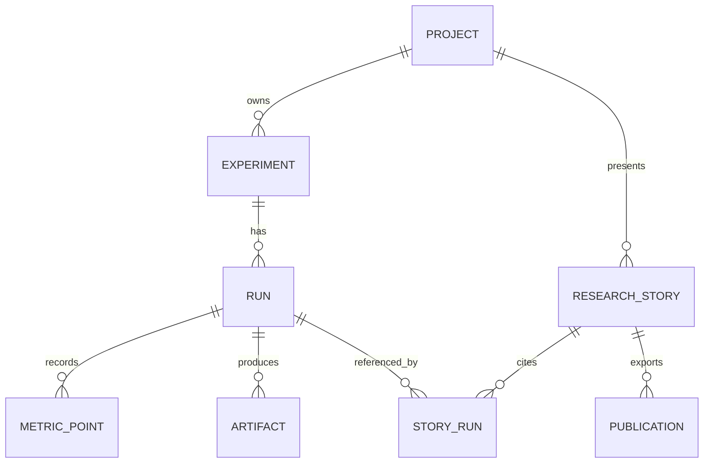

# ResearchLab — Domain Model

> Status: Draft v0.1 · 2026-10-24
> Scope: single-user local MVP with exportable, read-only research publications.
> Key idea: **an Experiment describes a question; each Run captures one attempt to answer it; a Research Story interprets immutable evidence.**

## 1. Ubiquitous language

| Term | Meaning |
| --- | --- |
| **Project** | An imported engineering project: metadata, local workspace and optional Git repository. |
| **Task definition** | A declared trusted action, such as `build` or `benchmark`, loaded from project configuration. |
| **Experiment** | A research question plus a declared task and a schema of input parameters. |
| **Run** | One execution of an experiment with a frozen configuration and recorded provenance. |
| **Metric point** | A numeric observation produced during a particular run. |
| **Artifact** | A recorded output file, e.g. CSV, image, mesh, or report. |
| **Research Story** | Author-written explanation connecting fixed runs, charts, artifacts, and source history. |
| **Publication** | Immutable export of a Research Story and the evidence it references. |

## 2. Bounded responsibilities

**Catalog:** project metadata, paths, available tasks, and Git inspection.

**Research:** experiment definitions, runs, parameters, numeric observations, artifacts.

**Execution:** trusted command launch, lifecycle, process control, event parsing, and diagnostic logs.

**Publishing:** Story drafts, chart selections, consistent snapshots, HTML export.

Keep these as logical modules in a modular monolith. Separate processes or microservices are not required for MVP.

## 3. Entity relationships



`StoryRun` is a reference/join, not a duplicate of run data. A Story may cite runs from its own project only in MVP.

## 4. Core entities

### 4.1 Project (aggregate root)

- `Id`, `Name`, `Description?`, `CreatedAtUtc`.
- `WorkspacePath` (local only; never included in the public publication).
- `GitRemoteUrl?` (display/reference metadata, not an authenticated GitHub integration requirement).
- Project task definitions are loaded from a versioned local `researchlab.json` file; their contents are not trusted merely because they exist.

**Invariants:** a project has a stable ID independent of its path; importing a project does not automatically execute repository commands.

### 4.2 Experiment (aggregate root)

- `Id`, `ProjectId`, `Name`, `Description`, `TaskKey`.
- `ParameterDefinitions`: name, type (`int`, `double`, `bool`, `string`), required/default, optional range or allowed values.
- `CreatedAtUtc`, `UpdatedAtUtc`.

**Invariants:** a Run can start only with a valid parameter set and a defined task. Changes to an Experiment cannot silently change the configuration of prior Runs.

### 4.3 Run (aggregate root)

- `Id`, `ExperimentId`, `Status`, `CreatedAtUtc`, `StartedAtUtc?`, `FinishedAtUtc?`.
- `ParametersSnapshot` (the validated values used), `ExperimentSnapshot` (the task and relevant definitions at launch).
- `SourceSnapshot`: `GitHeadSha?`, `IsWorkingTreeDirty?`, `RepositoryUrl?`.
- `EnvironmentSnapshot`: OS, architecture, runtime/toolchain information where available; no claim of complete reproducibility.
- `ExitCode?`, `FailureReason?`, `Duration?`, `Timeout?`.
- Optional `ParentRunId?` for later re-runs; every retry creates a **new** Run.

**Invariants:** source/configuration/parameters become immutable once launched. Status and diagnostics may change only by valid lifecycle transitions. No terminal Run is restarted in place.

### 4.4 MetricPoint (child of Run)

- `Id`, `RunId`, `Name`, finite numeric `Value`, optional `Step`, `RecordedAtUtc`, optional `Unit`, ingestion `Sequence`.

**Invariants:** metric points are append-only; values must be finite (not NaN or infinity). A metric series is identified by run and name. Use `Sequence` to preserve arrival order even when steps or timestamps repeat. Reject or flag incompatible units within one series.

### 4.5 Artifact (child of Run)

- `Id`, `RunId`, `RelativePath`, `DisplayName`, `MediaType?`, `SizeBytes`, `Sha256`, `CreatedAtUtc`.

**Invariants:** copy or register files only from a designated run output directory, after canonical path containment checks including symlink handling. Do not expose arbitrary host paths. Once registered, an artifact is content-addressed or otherwise treated as immutable. Published artifacts must be explicitly selected.

### 4.6 ResearchStory (aggregate root)

- `Id`, `ProjectId`, `Title`, `Summary`, `BodyMarkdown`, `CreatedAtUtc`, `UpdatedAtUtc`.
- References to specific `RunId`s, `ArtifactId`s, and `ChartSpec`s (e.g. series name, selected runs, x-axis, unit).

**Invariants:** stories cannot fabricate metric data through chart configuration. A referenced Run must belong to the same Project in MVP. Markdown is sanitized when rendered. A Story draft may change; an existing publication does not.

### 4.7 Publication (immutable snapshot)

- `Id`, `StoryId`, `CreatedAtUtc`, `ContentDigest`, `ExportLocation`.
- Exported HTML, chart data, and explicitly selected artifact copies for that revision.

**Invariants:** an export is self-contained for reading and viewing retained plots, with no connection to the author's local API. Never export absolute local paths, secrets, unselected files, or executable capabilities. Editing a Story creates a new publication rather than mutating a previously published snapshot.

## 5. Run lifecycle

```text
Created ───────→ Running ───────→ Succeeded
    │               ├───────────→ Failed
    │               ├───────────→ Canceled
    │               ├───────────→ TimedOut
    │               └───────────→ Interrupted
    ├───────────→ Failed
    └───────────→ Canceled
```

- `Created`: validated and persisted; no process-start acknowledgement has been durably recorded.
- `Running`: OS process started, with recorded start time and process identity.
- `Succeeded`: process exited with code `0` and required collection/validation completed.
- `Failed`: launch failed before the OS process started (`Created → Failed`), the running process exited nonzero, or essential result processing failed (`Running → Failed`).
- `Canceled`: explicit cancellation requested and completion confirmed; may happen before start.
- `TimedOut`: run exceeded its configured limit and was terminated.
- `Interrupted`: the execution owner session ended before recording a terminal outcome; determined on recovery from verified ownership loss. Allowed from Created and Running. It does not assert child-process termination or invent missing startup evidence.

A process-start failure must not be represented as `Running`: only transition to `Running` after successful process start. A terminal status cannot transition again. Use optimistic concurrency/version checks to avoid conflicting terminal updates. Crash recovery may reconcile a stale `Running` record as `Interrupted`. No transparent automatic retries in MVP.

## 6. Execution contract (MVP)

### Trusted task configuration

Example `researchlab.json` (illustrative schema, versioned independently):

```json
{
  "schemaVersion": 1,
  "tasks": {
    "benchmark": {
      "executable": "./build/benchmark",
      "args": [],
      "timeoutSeconds": 120
    }
  }
}
```

ResearchLab runs explicitly trusted commands only after user action. Pass program and argument list separately; **do not invoke a command through a shell by default**. Resolve paths inside the allowed workspace. Preserve the validated project workspace as CWD for compatibility and allocate a dedicated output directory per Run under configured ResearchLab storage. Programs must use the absolute `RESEARCHLAB_OUTPUT_DIR` for results; ordinary relative writes still target CWD. Directory allocation is not filesystem isolation. Apply limits for duration and logs; output-file quotas and metric limits belong to M4. See the [M3.6 contract](docs/local-run-completion.md).

### Input parameters

Pass validated parameters to the child process via an environment variable such as `RESEARCHLAB_PARAMETERS_JSON`, or a file in the run directory. Expose `RESEARCHLAB_OUTPUT_DIR` as the directory for registered artifacts. Define encoding and size limits in the protocol specification.

### Structured output

Keep regular stdout/stderr as logs. Emit research events as newline-delimited JSON with a dedicated prefix, e.g.:

```text
@researchlab/v1 {"type":"metric","name":"residual","value":0.0024,"step":15,"unit":"1"}
@researchlab/v1 {"type":"artifact","path":"mesh.vtk"}
```

The prefix distinguishes protocol messages from arbitrary console output. Unknown event types or malformed payloads produce diagnostics, not silent corruption. Never trust a reported artifact path without containment validation. The protocol can later be implemented by thin C# and C++ SDKs or another transport.

## 7. Cross-entity invariants

1. Every `Experiment` belongs to exactly one `Project`.
2. Every `Run` belongs to exactly one `Experiment` and captures immutable launch input.
3. A `Run` may have zero or more metrics, artifacts, and log entries; failed runs still retain evidence.
4. Git SHA identifies committed source only. If working tree is dirty, mark the Run as **not fully reproducible from Git alone**; never imply otherwise.
5. A chart is a view of recorded metrics, not a source of truth.
6. Story references use stable IDs, not “latest run” pointers.
7. Publications resolve and bundle their referenced evidence at export time.
8. Running a public Story never calls the author’s local executor.

## 8. Suggested persistence / boundaries

- **SQLite + EF Core:** projects, experiments, runs, metrics, artifact metadata, stories, publications.
- **Filesystem:** log streams, registered immutable files, exported static pages.
- **Execution service:** a C# process runner using `ProcessStartInfo` with redirected streams, cancellation, timeout and process-tree shutdown handling.
- **ASP.NET Core API:** query and command endpoints; UI consumes application use cases, not persistence entities directly.
- **Blazor UI:** experiment list, Run detail, metric comparison chart, and Markdown Story editor/preview.

This separation allows a later switch from SQLite to PostgreSQL and from local process runner to remote workers without changing research vocabulary.

## 9. Minimum application operations

```text
ImportProject(path)
CreateExperiment(projectId, definition)
StartRun(experimentId, parameters) -> runId
CancelRun(runId)
GetRun(runId) / ListRuns(experimentId)
GetMetricSeries(runIds, metricName)
GetArtifact(artifactId)
SaveStory(storyDraft)
ExportStory(storyId) -> publicationId
```

Use stable typed identifiers at domain boundaries. Execution events are persisted through application services; external programs do not write directly into the database.

## 10. Design questions deliberately deferred

- Run queues, priorities, leases, and distributed worker ownership.
- Authentication/authorization and multi-tenancy.
- Data model for richer 2D/3D visualizations and large binary datasets.
- Public remote execution of whitelisted experiments in isolated sandboxes.
- Plugin loading, project marketplaces, and hosted repository webhooks.

**First test of the model:** a sample C++ benchmark produces three Runs, multiple metric series, an artifact, and a Story publication that remains readable after the local application is shut down.
