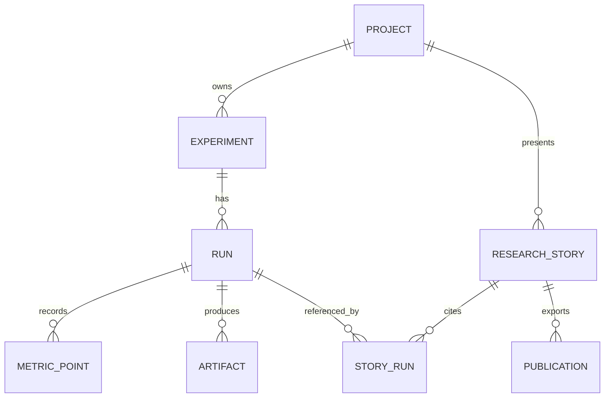

# ResearchLab — Доменная модель

> Статус: черновик v0.1 · 2026-10-24
> Область: локальный однопользовательский MVP с экспортируемыми исследовательскими публикациями только для чтения.
> Основная идея: **Experiment описывает исследовательский вопрос; каждый Run — попытку на него ответить; Research Story интерпретирует неизменяемые результаты.**

## 1. Единый язык предметной области

| Термин | Значение |
| --- | --- |
| **Project** | Импортированный инженерный проект: метаданные, локальная рабочая директория и необязательный Git-репозиторий. |
| **Task definition** | Объявленное доверенное действие, например `build` или `benchmark`, загруженное из конфигурации проекта. |
| **Experiment** | Исследовательский вопрос, выбранная задача и схема входных параметров. |
| **Run** | Одно выполнение эксперимента с зафиксированной конфигурацией и происхождением результатов. |
| **Metric point** | Числовое измерение, полученное в конкретном запуске. |
| **Artifact** | Зарегистрированный выходной файл, например CSV, изображение, сетка или отчёт. |
| **Research Story** | Авторский текст, связывающий конкретные запуски, графики, артефакты и историю кода. |
| **Publication** | Неизменяемый экспорт Research Story вместе с используемыми доказательными данными. |

## 2. Границы ответственности

**Catalog:** метаданные проектов, пути, доступные задачи и изучение состояния Git.

**Research:** определения экспериментов, запуски, параметры, числовые наблюдения и артефакты.

**Execution:** запуск доверенных команд, жизненный цикл, управление процессами, разбор событий и диагностические логи.

**Publishing:** черновики Story, выбранные графики, согласованные снимки данных и экспорт HTML.

Для MVP это логические модули модульного монолита; отдельные процессы и микросервисы не обязательны.

## 3. Связи сущностей



`StoryRun` — ссылка/связующая сущность, а не копия данных запуска. В MVP Story может ссылаться только на запуски своего проекта.

## 4. Основные сущности

### 4.1 Project (корень агрегата)

- `Id`, `Name`, `Description?`, `CreatedAtUtc`.
- `WorkspacePath` (только локально; никогда не включается в публичную публикацию).
- `GitRemoteUrl?` (сведения для отображения и ссылок; не предполагает обязательную авторизованную интеграцию с GitHub).
- Определения задач загружаются из локального версионированного `researchlab.json`; одно лишь наличие файла не делает команды доверенными.

**Инварианты:** стабильный идентификатор проекта не зависит от пути; импорт проекта не запускает команды из репозитория автоматически.

### 4.2 Experiment (корень агрегата)

- `Id`, `ProjectId`, `Name`, `Description`, `TaskKey`.
- `ParameterDefinitions`: имя, тип (`int`, `double`, `bool`, `string`), обязательность/значение по умолчанию, необязательный диапазон или допустимые значения.
- `CreatedAtUtc`, `UpdatedAtUtc`.

**Инварианты:** Run может стартовать только при наличии определённой задачи и корректного набора параметров. Изменение Experiment не изменяет конфигурации прошлых запусков.

### 4.3 Run (корень агрегата)

- `Id`, `ExperimentId`, `Status`, `CreatedAtUtc`, `StartedAtUtc?`, `FinishedAtUtc?`.
- `ParametersSnapshot` — проверенные значения запуска; `ExperimentSnapshot` — задача и существенные определения на момент старта.
- `SourceSnapshot`: `GitHeadSha?`, `IsWorkingTreeDirty?`, `RepositoryUrl?`.
- `EnvironmentSnapshot`: доступные сведения об ОС, архитектуре и runtime/toolchain; без заявления о полной воспроизводимости.
- `ExitCode?`, `FailureReason?`, `Duration?`, `Timeout?`.
- Необязательный `ParentRunId?` для повторных запусков; каждая повторная попытка создаёт **новый** Run.

**Инварианты:** версия кода, конфигурация и параметры неизменяемы после старта. Статус и диагностика изменяются только согласно допустимым переходам. Завершённый Run нельзя заново запустить на месте.

### 4.4 MetricPoint (дочерняя сущность Run)

- `Id`, `RunId`, `Name`, конечное числовое `Value`, необязательный `Step`, `RecordedAtUtc`, необязательный `Unit`, последовательность приёма `Sequence`.

**Инварианты:** измерения только добавляются; NaN и бесконечности недопустимы. Серия идентифицируется запуском и именем метрики. `Sequence` сохраняет порядок поступления даже при совпадении шага или времени. Несовместимые единицы внутри серии отклоняются либо явно отмечаются.

### 4.5 Artifact (дочерняя сущность Run)

- `Id`, `RunId`, `RelativePath`, `DisplayName`, `MediaType?`, `SizeBytes`, `Sha256`, `CreatedAtUtc`.

**Инварианты:** файлы регистрируются или копируются только из выделенной выходной директории запуска после проверки канонического пути, включая символические ссылки. Нельзя раскрывать произвольные пути хост-системы. Зарегистрированный артефакт считается неизменяемым либо хранится по содержимому. Артефакты для публикации выбираются явно.

### 4.6 ResearchStory (корень агрегата)

- `Id`, `ProjectId`, `Title`, `Summary`, `BodyMarkdown`, `CreatedAtUtc`, `UpdatedAtUtc`.
- Ссылки на конкретные `RunId`, `ArtifactId` и `ChartSpec` (например, имя серии, выбранные запуски, ось X, единица измерения).

**Инварианты:** конфигурация графика не может создавать вымышленные измерения. Run должен принадлежать тому же Project. Markdown проходит безопасную обработку при отображении. Черновик Story редактируется, уже экспортированная публикация — нет.

### 4.7 Publication (неизменяемый снимок)

- `Id`, `StoryId`, `CreatedAtUtc`, `ContentDigest`, `ExportLocation`.
- HTML, данные графиков и явно выбранные копии артефактов конкретной редакции.

**Инварианты:** экспорт самодостаточен для чтения и просмотра сохранённых графиков и не подключается к локальному API автора. Нельзя экспортировать абсолютные пути, секреты, невыбранные файлы и исполняемые возможности. Изменение Story создаёт новую публикацию, не изменяя старую.

## 5. Жизненный цикл Run

```text
Created ───────→ Running ───────→ Succeeded
    │               ├───────────→ Failed
    │               ├───────────→ Canceled
    │               ├───────────→ TimedOut
    │               └───────────→ Interrupted
    └───────────→ Canceled
```

- `Created`: параметры проверены и запись сохранена; выполнение ещё не началось.
- `Running`: процесс ОС запущен, сохранены время начала и идентификатор процесса.
- `Succeeded`: код завершения `0`, обязательный сбор и валидация результатов завершены.
- `Failed`: не удалось запустить процесс, ненулевой код завершения или ошибка критически важной обработки результатов.
- `Canceled`: явно запрошенная отмена подтверждена; возможна и до старта.
- `TimedOut`: достигнут лимит времени, выполнение прекращено.
- `Interrupted`: сервис исполнения завершился аварийно или был остановлен до регистрации штатного результата; выявляется при восстановлении.

Терминальные состояния неизменяемы. Для защиты от конфликтующих обновлений применять проверку версии/оптимистическую конкурентность. При восстановлении устаревший `Running` может стать `Interrupted`. Автоматических скрытых повторов в MVP нет.

## 6. Контракт выполнения (MVP)

### Конфигурация доверенных задач

Пример `researchlab.json` (иллюстративная схема с отдельным версионированием):

```json
{
  "schemaVersion": 1,
  "tasks": {
    "benchmark": {
      "executable": "./build/benchmark",
      "args": [],
      "timeoutSeconds": 120
    }
  }
}
```

ResearchLab выполняет явно доверенные команды только после действия пользователя. Передавать исполняемый файл и аргументы раздельно; **не запускать команды через оболочку по умолчанию**. Разрешать пути в пределах допустимого workspace. Выделять рабочую/выходную директорию и ограничивать продолжительность, размер вывода и число метрик.

### Входные параметры

Проверенные параметры передаются дочернему процессу через переменную окружения `RESEARCHLAB_PARAMETERS_JSON` или файл в директории запуска. `RESEARCHLAB_OUTPUT_DIR` задаёт место для регистрируемых артефактов. Кодировку и максимальные размеры следует определить в спецификации протокола.

### Структурированный вывод

Обычные stdout/stderr остаются логами. Исследовательские события выводятся построчным JSON с отдельным префиксом:

```text
@researchlab/v1 {"type":"metric","name":"residual","value":0.0024,"step":15,"unit":"1"}
@researchlab/v1 {"type":"artifact","path":"mesh.vtk"}
```

Префикс отделяет события протокола от обычного консольного вывода. Неизвестный тип события и некорректные данные формируют диагностику, а не тихо повреждают состояние. Пути артефактов обязательно проверяются на принадлежность разрешённой директории. В дальнейшем можно добавить тонкие SDK для C# и C++ либо другой транспорт.

## 7. Инварианты между сущностями

1. Каждый `Experiment` принадлежит ровно одному `Project`.
2. Каждый `Run` принадлежит ровно одному `Experiment` и сохраняет неизменяемые входные данные запуска.
3. Run может иметь любое количество метрик, артефактов и логов; результаты неуспешных запусков тоже сохраняются.
4. Git SHA определяет только закоммиченный код. Если рабочее дерево изменено, Run помечается как **не полностью воспроизводимый только по Git**.
5. График — представление зарегистрированных метрик, а не источник истины.
6. Story ссылается по стабильным ID, а не на «последний запуск».
7. Публикации фиксируют и включают необходимые доказательные данные во время экспорта.
8. Публичная Story никогда не обращается к локальному исполнителю автора.

## 8. Хранение и границы компонентов

- **SQLite + EF Core:** проекты, эксперименты, запуски, метрики, метаданные артефактов, истории и публикации.
- **Файловая система:** логи, зарегистрированные неизменяемые файлы и экспортированные статические страницы.
- **Execution service:** C#-исполнитель на `ProcessStartInfo` с перенаправлением потоков, отменой, тайм-аутом и завершением дерева процессов.
- **ASP.NET Core API:** операции записи и чтения; UI обращается к сценариям приложения, а не напрямую к сущностям хранения.
- **Blazor UI:** список экспериментов, подробности Run, графики сравнения и редактор/предпросмотр Markdown Story.

Это позволит позже заменить SQLite на PostgreSQL, а локальный исполнитель — удалёнными воркерами, не меняя исследовательские понятия.

## 9. Минимальные операции приложения

```text
ImportProject(path)
CreateExperiment(projectId, definition)
StartRun(experimentId, parameters) -> runId
CancelRun(runId)
GetRun(runId) / ListRuns(experimentId)
GetMetricSeries(runIds, metricName)
GetArtifact(artifactId)
SaveStory(storyDraft)
ExportStory(storyId) -> publicationId
```

На доменных границах использовать стабильные типизированные идентификаторы. События исполнения сохраняются через сервисы приложения; внешние программы не пишут в БД напрямую.

## 10. Вопросы, сознательно отложенные

- Очереди, приоритеты, leases и владение задачами распределёнными воркерами.
- Аутентификация, авторизация и мультитенантность.
- Более богатая модель 2D/3D-визуализации и крупных бинарных наборов данных.
- Публичное удалённое выполнение разрешённых экспериментов в изолированных средах.
- Подгрузка плагинов, каталоги проектов и Git-webhooks.

**Первая проверка модели:** пример C++-бенчмарка создаёт три Run, несколько серий метрик, артефакт и публикацию Story, которая открывается после остановки локального приложения.
